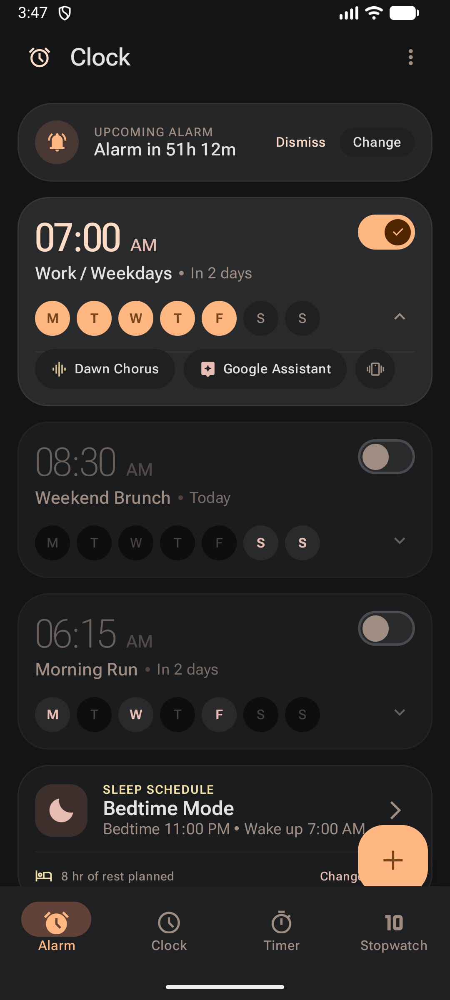
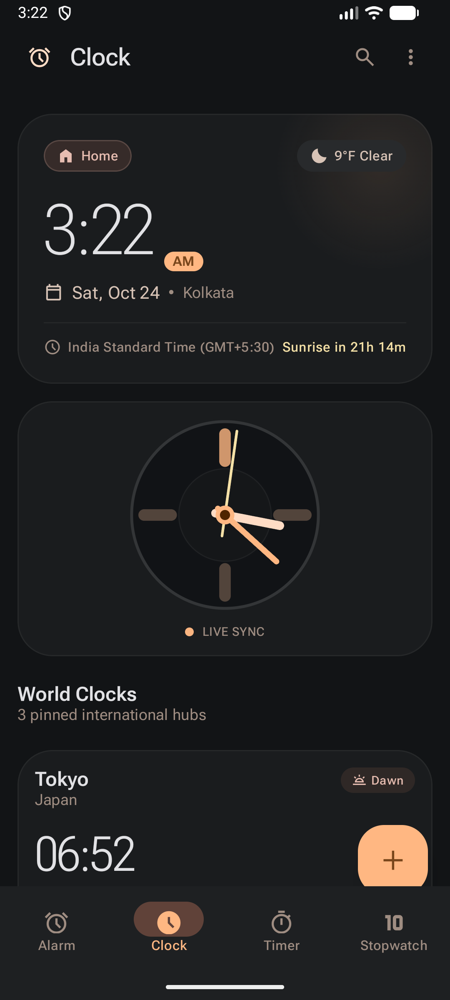
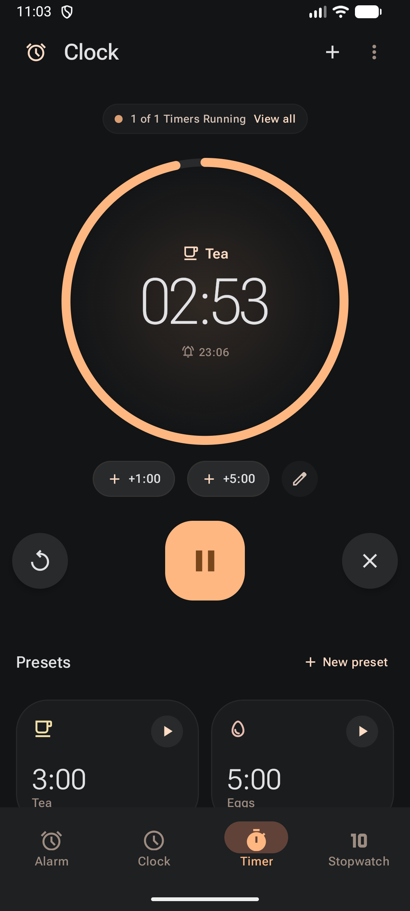
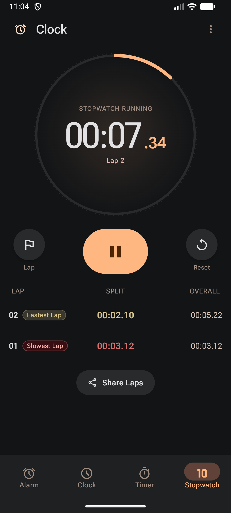

# Chronos

An Android clock app built strictly from the **Chronos M3** design system — a
Material 3 Expressive, night-optimised clock with a warm amber key colour over true
OLED black surfaces.

Written in **Kotlin** with **Jetpack Compose** and **Material 3**, targeting
Android 8.0 (API 26) and newer.

| Alarm | Clock | Timer | Stopwatch |
|---|---|---|---|
|  |  |  |  |

📦 [Download the APK from the Releases page](https://github.com/mickykhd/chronos/releases)

---

## Features

### 🔔 Alarm
- A **full-screen alarm editor** — the same set of options a phone clock exposes:
  time, repeat days, label, **sound**, **vibration pattern** and **snooze**.
- A **hand-built animated dial** for picking the time. The Material 3 `TimePicker`
  renders a display row far too large for a dialog on a phone (the digits clip), so
  Chronos draws its own: the numbers never overflow, the selection slides between
  positions, and the hand springs to wherever your finger lands.
- **Sound picker** listing the ringtones, alarm tones and notification sounds
  actually installed on the device, read live from the media store.
- **Vibration patterns** — off, standard, twice or continuous.
- Repeating schedules with ISO day-of-week selection (M T W T F S S pills).
- Material 3 switches built to spec: 52×32 dp track, 24 dp thumb, check glyph when on.
- **Real scheduling** through `AlarmManager.setExactAndAllowWhileIdle` — the alarm
  fires even if the app is not running, and alarms are re-booked after a reboot.
- **A real ringtone.** The tone is played with an explicit `MediaPlayer` on the
  alarm stream with audio focus, alongside the vibration pattern, and it keeps
  playing until the alarm is dismissed or snoozed.
- A **full-screen alarm UI** that shows over the lock screen with the screen woken,
  plus Dismiss and Snooze actions on the notification itself.
- A bedtime / sleep-schedule card you can switch on from the overflow menu.

> A fresh install starts **completely empty** — no demo alarms and no pinned cities.
> The app never pre-fills data you did not create.

### 🕐 Clock
- **Search** that filters your pinned cities by name or country.
- Live local time in a `display-hero` readout with a `display-hero-mobile` fallback.
- A **live analog dial** whose second hand sweeps continuously (60 s linear)
  rather than ticking, rendered entirely on the Compose canvas.
- **Real world clocks** — each pinned city is computed from its IANA time zone, so
  the offset and the day/night badge are always truthful.
- **Live weather** from the [Open-Meteo](https://open-meteo.com/) API (no key
  required) on the hero card and every city row.
- **Real sunrise / sunset** computed with the NOAA solar-position algorithm, so
  "Sunrise in 8h 12m" is correct wherever the device is.
- "Coordinate Meeting" sheet comparing waking hours across every pinned city.

### ⏲ Timer
- Multiple **concurrent** countdowns, each with its own progress ring.
- Presets (Tea, Eggs, Meditation, Pomodoro) plus `+1:00` / `+5:00` quick adds.
- A **foreground service** keeps an ongoing notification with a live countdown.
  The completion event is also scheduled with `AlarmManager`, so the "time's up"
  notification survives the app being killed.
- Reset, pause/resume and cancel, with the ring animating to each new state.

### ⏱ Stopwatch
- Millisecond-accurate timing with a 60-second sweep gauge and a tick ring.
- Lap table with **fastest lap** highlighted in tertiary brass and **slowest lap**
  in muted crimson, exactly as the design system specifies.
- Share laps to any app via `ACTION_SEND`.

---

## Colour themes

Six accent palettes ship with the app, selectable in **Settings**: **Ember** (the
original Chronos M3 key colour), **Aurora**, **Orchid**, **Solar**, **Frost** and
**Graphite**.

The surface tiers never change — the app stays true OLED black in every theme — so
switching theme changes the key colour without losing the night-optimised
foundation the design system is built on. Your choice is remembered.

A **24-hour format** setting is there too, and applies to the hero clock, the
world clocks and the alarm editor.

## Design system

Everything is driven from [`docs/design/chronos_m3/DESIGN.md`](docs/design/chronos_m3/DESIGN.md).
The original Stitch mock-ups are kept in [`docs/design/`](docs/design/) for reference.

| Token group | Notes |
|---|---|
| **Colour** | The full M3 palette, applied verbatim: base canvas `#121416`, tiered containers `#0C0E10` → `#333537`, amber key colour `#FFB782`, terracotta secondary `#E7BDB1`, brass tertiary `#D8C58D`. |
| **Type** | Roboto Flex, bundled as the **variable font** so the `wght` and `opsz` axes stay live. Two families are exposed — a text-tuned instance (`opsz 14`) and a display-tuned instance (`opsz 60`) for the oversized hero numerals. Every numeric readout uses OpenType **tabular figures** so rapidly incrementing values never jitter. |
| **Shape** | Squircle-curved containers (`28–32 dp` cards) and full capsules for every pill. |
| **Elevation** | Communicated through **tonal colour shifts**, not drop shadows — except the FAB, which carries the design's warm ambient bounce. |
| **Icons** | Material Symbols Outlined, bundled as a subsetted variable font (283 KB, down from 10.7 MB) that keeps the `FILL`, `opsz` and `wght` axes, so filled and outlined variants are both available at runtime. |

### Motion

Motion is a first-class part of the design system, not an afterthought:

- **Tab transitions** — a directional fade + slide + scale, forward or backward
  depending on which way you moved through the dock.
- **A travelling nav indicator** — one pill *slides* between tabs on a spring
  rather than four indicators cross-fading.
- **Staggered entrances** — every screen assembles itself in sequence.
- **Spring-driven micro-interactions** — switches, day pills, chips, the FAB and
  the play/pause button all compress under the finger and spring back, with
  haptic feedback.
- **Animated gauges** — the timer ring and the stopwatch sweep are spring-animated
  rather than snapped.
- **Expand / collapse** on alarm details with a coordinated fade and height spring.
- **Pulsing live indicators** — the "Live Sync" dot and the timer status dot.
- **Material 3 Expressive motion tokens** live in
  [`ChronosMotion`](app/src/main/java/com/chronos/clock/ui/theme/Motion.kt) —
  emphasized curves plus tuned springs.
- **A working overflow menu on every tab** (Settings, Add alarm, Add city, Compare
  times, Bedtime mode) and a **working search field** on the world clock.

---

## Architecture

```
com.chronos.clock
├── ChronosApp.kt            Root: nav dock, destination transitions, sheets
├── MainActivity.kt          Edge-to-edge host, notification permission
├── core/                    Sun times, weather, live clock, zone helpers
├── data/                    Models + ChronosRepository (SharedPreferences + JSON)
├── service/                 AlarmManager scheduling, receivers, foreground services
└── ui/
    ├── theme/               Colour, type, shape, motion and dimension tokens
    ├── components/          Reusable UI: icons, gauge, switch, nav, buttons
    ├── alarm/  clock/  timer/  stopwatch/    One screen + ViewModel each
```

- **State** — `ViewModel` + `StateFlow`, with a single repository as the source of
  truth. Everything is persisted as JSON in `SharedPreferences`, so the process can
  be killed at any time without losing alarms, timers, pins or laps.
- **Timers** — a running timer stores an absolute `endAt` timestamp, so the
  remaining time is reconstructed correctly after a process death.
- **Alarms** — `AlarmManager` + `BootReceiver` keep the platform schedule in sync
  with the switch in the UI.

---

## Building

```bash
git clone https://github.com/mickykhd/chronos.git
cd chronos
./gradlew :app:assembleDebug      # debug APK
./gradlew :app:assembleRelease    # release APK
```

Requirements: JDK 17 and the Android SDK (compileSdk 36, build-tools 36).

### Release signing

The release build signs with the Android debug key unless a `keystore.properties`
file is present, so the APK is always installable out of the box. To sign with
your own key:

```bash
cp keystore.properties.example keystore.properties
# then fill in the values for your key
./gradlew :app:assembleRelease
```

`keystore.properties` and `keystore/` are git-ignored.

The APK attached to the GitHub release is signed with a release key generated
locally. The key lives in `keystore/chronos-release.jks` and the credentials in
`keystore.properties`, both on this machine only — **back them up**, because a
published Android app can only be updated with the same key.

---

## Permissions

| Permission | Why |
|---|---|
| `USE_EXACT_ALARM` | Alarms and timers must fire to the minute. |
| `RECEIVE_BOOT_COMPLETED` | Re-book alarms after a reboot. |
| `POST_NOTIFICATIONS` | Alarm and timer notifications (Android 13+). |
| `FOREGROUND_SERVICE` (+ `SPECIAL_USE`, `MEDIA_PLAYBACK`) | Keep the timer countdown alive; play the alarm tone. |
| `INTERNET` | Live weather from Open-Meteo. |
| `VIBRATE`, `WAKE_LOCK` | Alarm haptics and playback while the device sleeps. |

---

## Credits

- Design system and mock-ups: **Chronos M3** (bundled in `docs/design/`).
- [Roboto Flex](https://fonts.google.com/specimen/Roboto+Flex) and
  [Material Symbols](https://fonts.google.com/icons) — SIL Open Font License 1.1.
- Weather data: [Open-Meteo](https://open-meteo.com/) (CC BY 4.0).

## License

MIT — see [LICENSE](LICENSE).
